# ctrlTask

[](https://github.com/BrendanLTW/ctrltask/actions/workflows/ci.yml)

**Get today done, one tap at a time.** ctrlTask is a private, offline task and focus app for iOS and Android. Capture a task in seconds, see today's progress fill a ring, group work into projects, and focus with a Pomodoro timer. There's no account and no sync, and nothing leaves the phone except a file you export yourself.

Built in Flutter as a portfolio project, where architecture, tests and design fidelity matter more than feature count. ctrlTask is from ctrlWorks and shares its design system with [ctrlSpend](https://github.com/BrendanLTW/ctrlspend).

| | Home | Tasks | Calendar | Projects | Project | Task | Focus | Insights |
|---|---|---|---|---|---|---|---|---|
| **Light** | 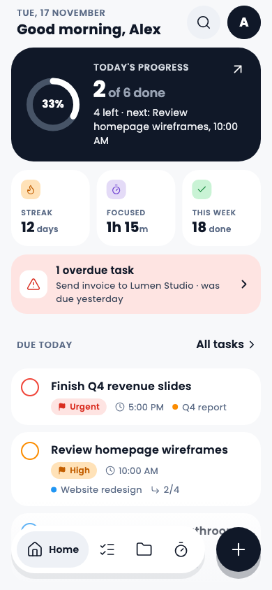 | 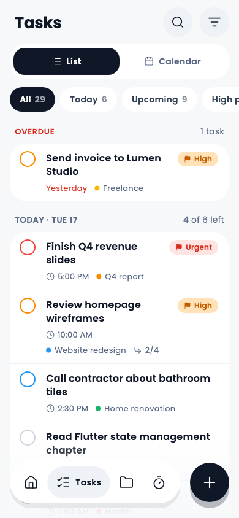 | 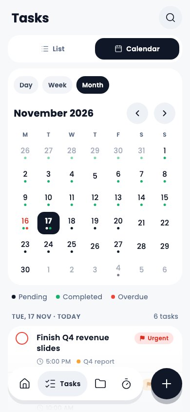 | 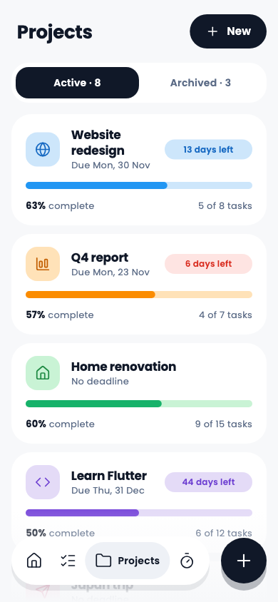 | 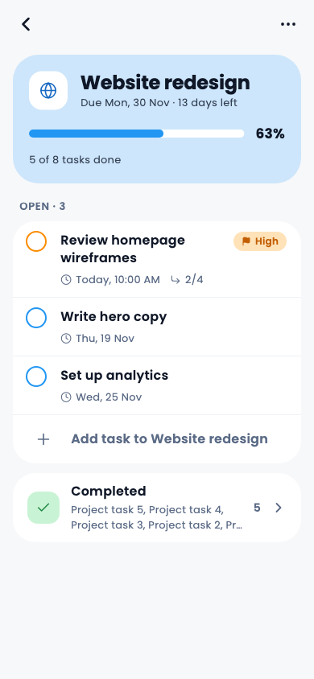 | 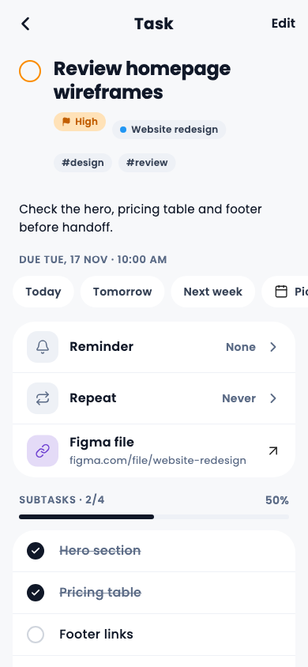 | 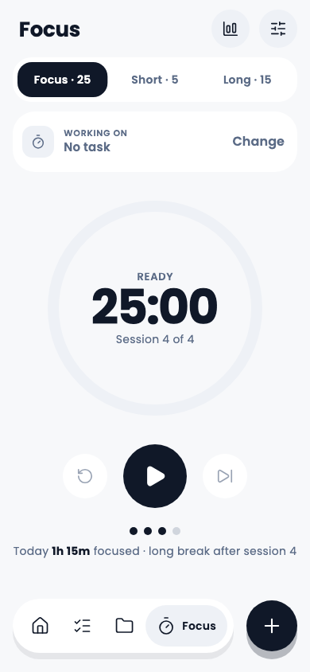 | 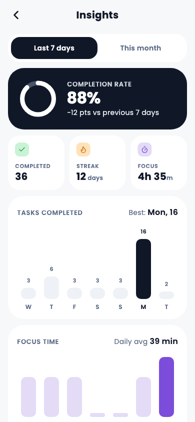 |
| **Dark** | 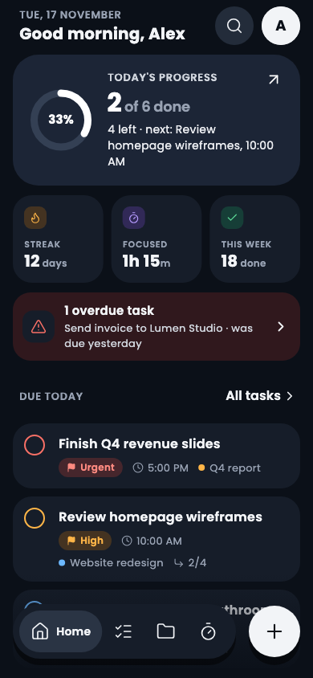 | 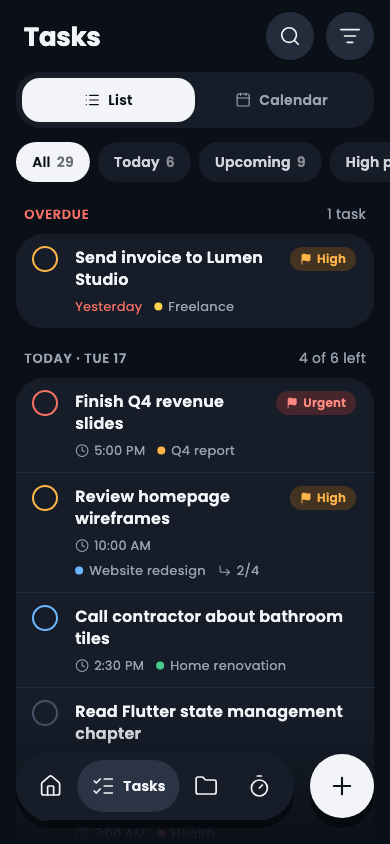 | 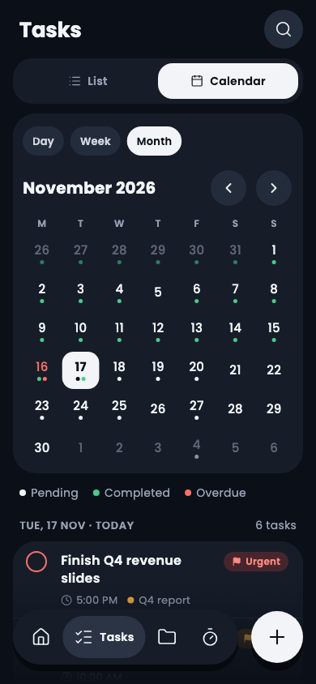 | 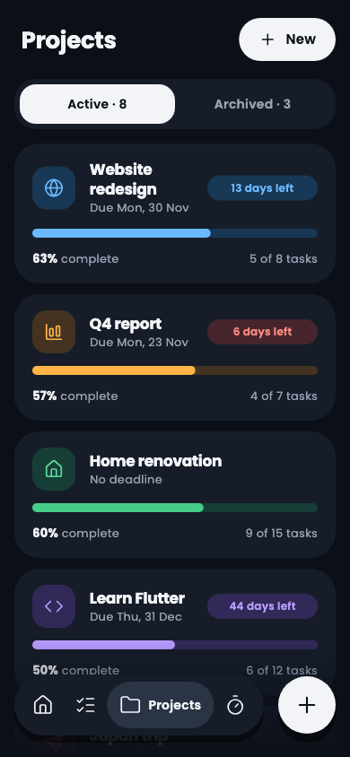 | 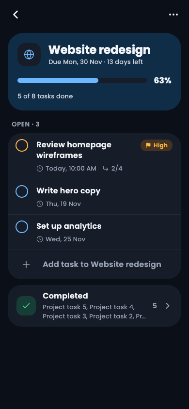 | 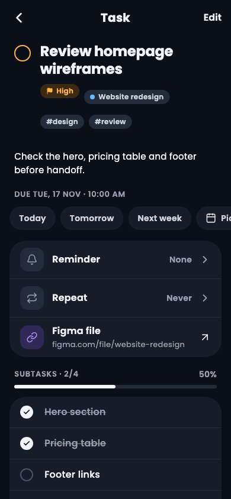 | 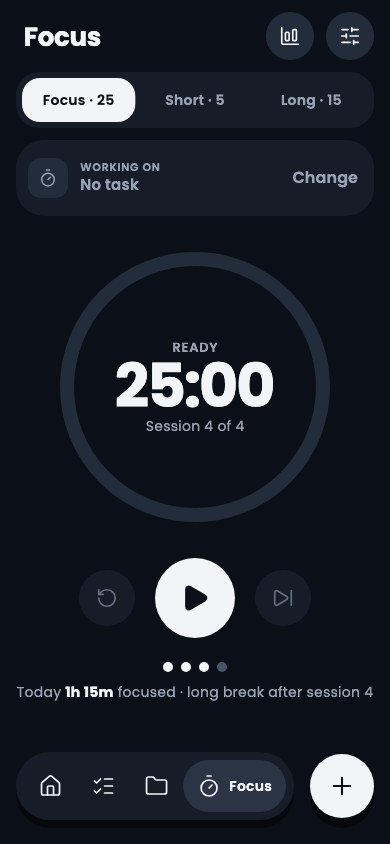 | 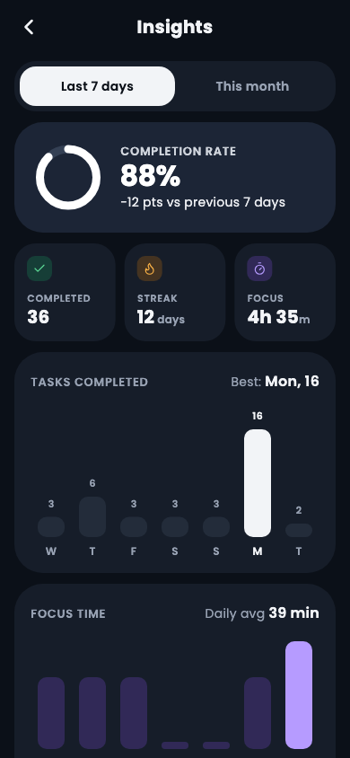 |

## Features

- **Today at a glance.** Home shows a progress ring, your streak, focus time and what's done this week, an overdue banner, and today's tasks in order.
- **Quick add** from anywhere: a title, when (Today, Tomorrow · 9 AM, the coming Saturday or a date), priority, project, tags, a reminder and a repeat, all in one sheet.
- **Complete with one tap.** The tick, the strikethrough, a haptic and a toast with Undo for 3.5 seconds. Undo reverses everything, the streak included. A repeating task moves to its next date.
- **Tasks** in sections (Overdue, Today, Tomorrow, This week, Later, No date), with filter chips, sorting, search, and swipe to reschedule or delete. A **calendar** shows the month, week and a day timeline.
- **Projects** with a colour, an icon, a deadline and progress. Move tasks between them, archive a finished one and restore it later.
- **Task detail:** subtasks, notes, links, tags, reminders, and repeats (daily, weekdays, weekly on chosen days, monthly, or every N days, weeks or months, with an end date).
- **Focus.** A Pomodoro timer with short and long breaks, linked to a task, that keeps running correctly while the app is closed.
- **Insights:** completion rate and its change, tasks and focus by day, a 6-week trend and your power day.
- **Local notifications:** task reminders, a daily plan, overdue nudges, session ends and a weekly review, with quiet hours.
- **Export** to CSV or JSON for a range, light, dark or system theme, your week's start day, a default priority, and Erase all data.

## Tech stack

Flutter (stable, Dart 3) · Riverpod 3 with code generation · Drift (SQLite) with versioned migrations · go_router with a `StatefulShellRoute` · freezed · intl · flutter_local_notifications with timezone · flutter_svg with bundled Lucide icons · share_plus and csv for export · very_good_analysis. Charts are drawn with `CustomPainter`, with no chart package.

## Architecture

The code is organised feature first, and each feature has three layers:
- `domain/` is pure Dart: entities, repository interfaces and every calculation, such as `weekOf`, `sectionFor`, `nextOccurrence`, the streak, the completion rate and the power day.
- `data/` implements those interfaces with Drift or a platform plugin.
- `presentation/` holds screens and widgets, which only see the interfaces, through Riverpod providers.

`main.dart` is the one place that wires the real implementations in (`appOverrides()` and `platformOverrides()`), so tests swap in fakes the same way.

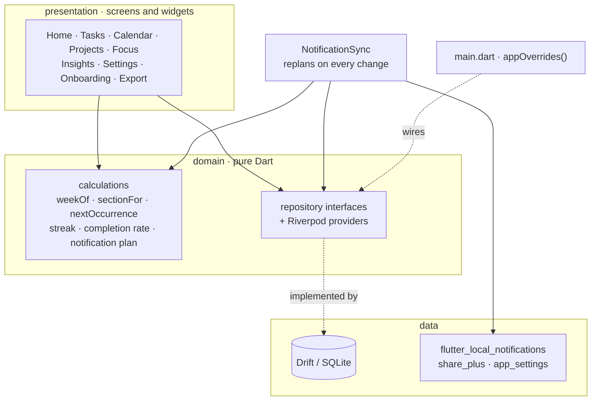

## Key decisions

- **Offline first, private by default.** There's no account, no network call, no analytics and no crash reporting. Data leaves the phone only through an export you choose to share. Everything works in airplane mode.
- **Navy over purple.** The accent is a navy `ink` rather than the usual productivity purple. It reads as calm and serious, holds contrast in both themes, and lets priority colours (urgent red, high orange, medium blue) stand out. Brand orange is kept to the logo, app icon and splash. Colour is never the only signal: a priority always has its word or flag beside it.
- **The timer is computed from timestamps.** The focus timer stores when a session started and how long it's planned for, and works out what's left from the clock. A running timer is never trusted to survive the background. A session that ran out while the app was closed or suspended finishes as soon as the app is back.
- **One way to complete a task.** Every tick goes through one use case: strikethrough, haptic, toast and Undo, and the next occurrence for a repeat. So Undo reverses all of it, everywhere.
- **Repeats advance from the due date**, never from when you finished, so a weekly task stays on its weekday even when you're late.
- **One notification service owns scheduling.** It plans every reminder from the data and replaces what's scheduled whenever tasks or settings change, within iOS's 64-notification limit.
- **Dates are local days, timestamps are UTC.** Due dates are calendar days with optional minutes; created, completed and focus times are stored in UTC and shown in local time.

## Running

```sh
flutter pub get
dart run build_runner build --delete-conflicting-outputs
flutter run
```

- `flutter run --dart-define=DEMO=true` opens the design's sample data (Alex, Tue 17 Nov 2026) in memory. Debug builds only.
- `flutter run --profile --dart-define=PERF=true` runs on its own database of 2,000 tasks and a year of focus. See [docs/performance.md](docs/performance.md).

## Testing

```sh
flutter analyze
flutter test                                          # unit and widget tests
flutter test integration_test/app_test.dart -d <id>   # end to end on a device
```

- **Unit tests** cover every repository on an in-memory database and every derived value, with exhaustive `nextOccurrence` cases.
- **Widget tests** run every screen in light and dark, and at 200% text.
- **`test/accessibility_test.dart`** checks 44 px touch targets, labels and 4.5:1 contrast on every screen.
- **The end-to-end test** goes onboarding → quick add → complete → undo → a focus session.

CI runs codegen, analyze and the tests on every push.

## Docs

- [PRD](docs/PRD.md): requirements, screens and acceptance criteria
- [DESIGN](docs/DESIGN.md): tokens and components
- [Design notes](docs/design-notes.md): where the app knowingly differs from the designs
- [Export formats](docs/export-format.md)
- [Performance](docs/performance.md)
- [PLAN](docs/PLAN.md): the build, task by task

## Releases

Android APKs are attached to [GitHub Releases](https://github.com/BrendanLTW/ctrltask/releases), signed with the ctrlTask release key. Install by sideloading. iOS builds need your own signing in Xcode.
